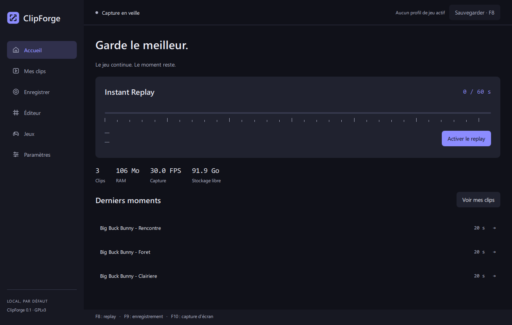
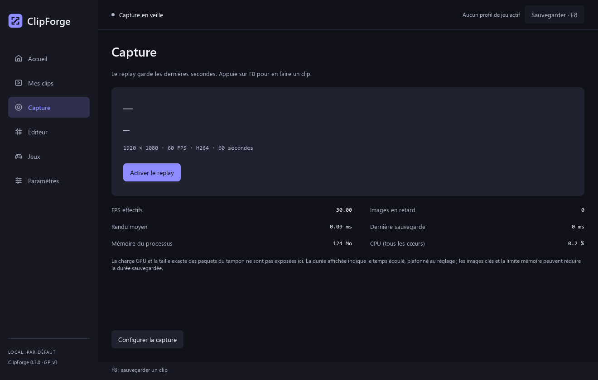
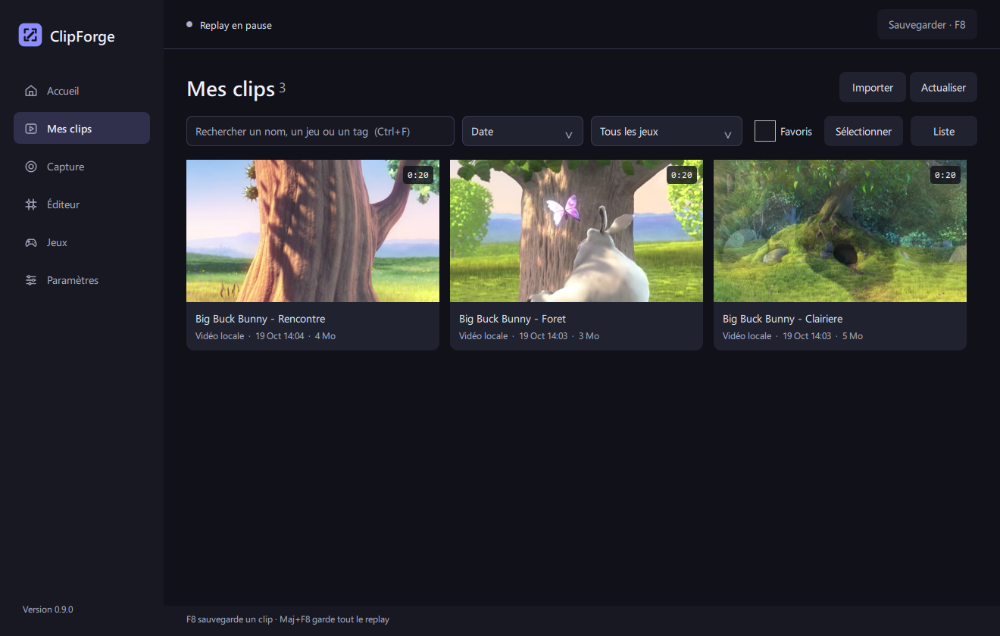
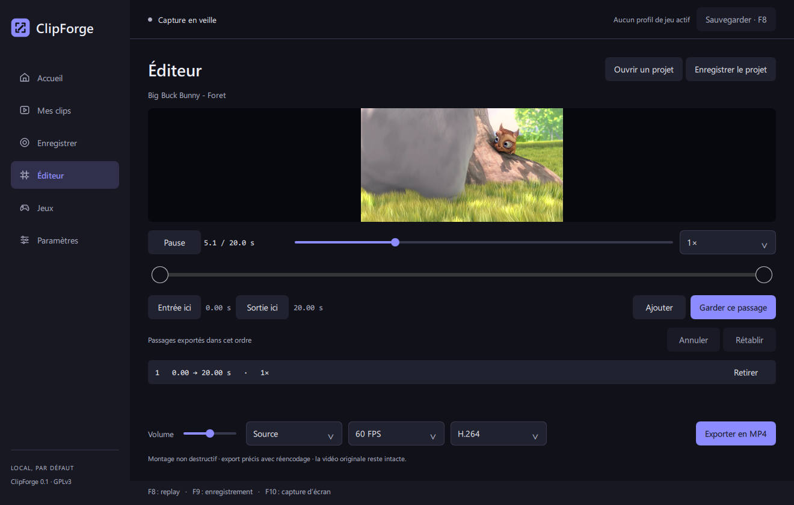

<p align="center">
  
</p>

<h1 align="center">ClipForge</h1>

<p align="center">
  <strong>Replay instantané pour Windows : garde les dernières secondes de ton jeu, d'un raccourci.</strong><br>
  Natif, hors ligne, léger. C++20 · Qt Quick · libobs · FFmpeg · SQLite
</p>

<p align="center">
  <a href="https://github.com/Lololegeek/ClipForge/releases/latest"></a>
  <a href="LICENSE"></a>
  
  
</p>

<p align="center">
  <a href="https://github.com/Lololegeek/ClipForge/releases/latest/download/ClipForge-Setup-x64.exe"><strong>⬇ Installateur Windows x64</strong></a>
  &nbsp;·&nbsp;
  <a href="https://github.com/Lololegeek/ClipForge/releases/latest/download/ClipForge-Windows-x64.zip">ZIP portable</a>
  &nbsp;·&nbsp;
  <a href="https://lololegeek.github.io/ClipForge/">Site</a>
</p>

---

## ✨ En bref

ClipForge tourne en arrière-plan pendant que tu joues. Appuie sur **F8** et il sauvegarde les **60 dernières secondes** en MP4, sans ralentir le jeu. Ensuite, tu coupes, tu exportes et tu partages depuis l'éditeur intégré.

- 🎮 **Testé en jeu** : Valorant (Vanguard) et Fortnite (EAC), raccourci fonctionnel en plein écran exclusif.
- ⚡ **Léger** : 0,77 % de CPU et environ 300 Mo de RAM en 1080p60 mesurés.
- 🔒 **Hors ligne** : aucun compte, aucune télémétrie, aucune activation en ligne.
- 🧩 **Tous les encodeurs** : AMF, NVENC, QSV et x264, en H.264, HEVC et AV1 selon le matériel.
- 🇫🇷 **Interface et documentation en français.**

## 📸 Aperçu

<p align="center">
  
  
</p>
<p align="center">
  
  
</p>

## 🚀 Fonctionnalités

| Domaine | Ce que tu obtiens |
|---|---|
| **Replay** | Tampon compressé en mémoire via libobs. Durée et mémoire réglables (60 s et 512 Mo par défaut). Une sauvegarde à la fois, protégée contre le spam de raccourci. |
| **Capture** | Écran (Windows Graphics Capture, repli DXGI signalé), fenêtre (WGC, repli BitBlt signalé) et source de jeu OBS standard. Sortie MP4. |
| **Encodage** | Choix automatique AMF, NVENC ou QSV, avec repli x264 si le GPU ne répond pas. H.264 par défaut, 1080p60, 16 Mbit/s. |
| **Audio** | Son système WASAPI, son d'une seule application, micro facultatif (désactivé par défaut). Une piste AAC mixée. |
| **Raccourci** | F8 par défaut, réglable de F1 à F24. Conflit signalé, pas de collision silencieuse. |
| **Notification** | Confirmation en jeu de 3 secondes à chaque clip sauvegardé (fenêtre ou plein écran sans bordure). |
| **Bibliothèque** | SQLite, miniatures, recherche, tri, favoris, étiquettes, renommage, corbeille, import, fichiers manquants signalés. |
| **Éditeur** | Découpe précise, plusieurs passages depuis une même source, vitesse, gain, annuler/rétablir, projets enregistrés. Export MP4 H.264 ou HEVC. Les originaux sont conservés. |
| **Jeux** | Profils par jeu, démarrage automatique pour les profils connus au premier plan. Un processus inconnu n'est jamais pris pour un jeu. |
| **Réglages** | Fichier JSON validé et écrit de façon atomique, import et export de la configuration, démarrage avec Windows, mises à jour GitHub facultatives. |

## 📊 Performances mesurées

Mesures faites le **24 novembre 2026** sur le build **1.0.1**, avec **Ryzen 7 8700F (8 cœurs / 16 threads), 32 Go de RAM, Radeon RX 6600** (pilote 32.0.21045.29003), Windows 11. Chaque configuration a été lancée **3 fois** avec le harnais de test intégré (`--self-test`), replay de 60 s, capture de l'écran.

| Configuration | CPU moyen (tous cœurs) | RAM (pic) | Temps de sauvegarde | Frames en retard |
|---|---|---|---|---|
| 1080p60 · AMF H.264 · 16 Mbit/s | **0,77 %** (0,76 à 0,78) | 299 Mo | 247 à 266 ms (médiane 255 ms) | 1 par passe |
| 720p30 · AMF H.264 · 5 Mbit/s | **0,57 %** (0,51 à 0,66) | 205 Mo | 191 à 224 ms (médiane 213 ms) | 0 |
| 720p30 · x264 logiciel (repli) | 1,77 % (1,44 à 2,26) | 466 Mo | 1319 à 1346 ms (médiane 1330 ms) | 0 |

- Aucune frame sautée sur les 9 passes.
- Ces chiffres mesurent ClipForge seul, pendant une capture de bureau, sans jeu. Ils ne disent pas combien un jeu perd de FPS : cette mesure instrumentée n'a pas encore été faite. Compare avec le même réglage et le même scénario de jeu, sur ton matériel.
- Les mesures précédentes (octobre 2026, pilote 32.0.21045.5002) donnaient 0,66 % de CPU et 276 Mo de RAM en 1080p60. Ces chiffres-ci les remplacent.
- **En jeu**, sur plusieurs sessions de **5 heures et plus** : RAM d'environ 300 Mo au maximum, impact CPU négligeable (observation du mainteneur, sans chiffres exacts).

## 🎮 Testé en jeu

- **Valorant** (anti-triche Vanguard) et **Fortnite** (Easy Anti-Cheat) : le raccourci de sauvegarde fonctionne **en plein écran exclusif**, et la notification est visible par-dessus le jeu.
- **Tous les encodeurs** (AMF, NVENC, QSV, x264) sont testés et fonctionnent, en jeu comme sur le bureau.
- Aucun contournement d'anti-triche : ClipForge utilise la capture standard d'OBS et Windows Graphics Capture, sans injection cachée.

## ⚠️ Limites connues

- Pas de tampon temporaire sur disque : la mémoire est la seule réserve de replay.
- Une seule piste audio mixée, pas de vumètre en direct, pas de changement d'appareil à chaud.
- L'éditeur réencode toujours l'export ; pas de recadrage vertical, de texte ni de sous-titres.
- Non couvert par les tests documentés : Windows 10, une VM propre, et l'impact FPS instrumenté en jeu.

## 🛠️ Démarrage rapide

1. Télécharge et lance l'[installateur](https://github.com/Lololegeek/ClipForge/releases/latest/download/ClipForge-Setup-x64.exe). Il s'installe pour l'utilisateur courant, sans droits administrateur.
2. Ouvre **Paramètres**, choisis l'écran ou la fenêtre, puis active la relecture instantanée.
3. Joue. Appuie sur **F8** pour sauvegarder les dernières secondes.
4. Ouvre **Mes clips** pour découper et exporter.

Fermer la fenêtre laisse la capture tourner dans la barre des tâches. Pour quitter, utilise **Quitter** dans le menu de la barre des tâches.

## 🧱 Compilation

Installe Visual Studio avec MSVC x64 et un Windows SDK, CMake, Ninja, Python (téléchargement des dépendances uniquement), 7-Zip et FFmpeg/FFprobe. Dans PowerShell 7 :

```powershell
cd 'D:\Code 2\LoloClips'
./scripts/bootstrap.ps1
./scripts/build.ps1
./scripts/package.ps1
./scripts/test.ps1
```

Les dépendances sont isolées dans `.deps`. Python n'est jamais utilisé par l'application elle-même.

## 📚 Documentation

- [Compilation et déploiement](docs/BUILDING.md)
- [Comportement et limites de la capture](docs/CAPTURE.md)
- [Périmètre de la 1.0](docs/FEATURES.md)
- [Architecture](docs/ARCHITECTURE.md)
- [Captures du site et attribution](docs/SCREENSHOTS.md)
- [Inventaire des composants tiers](THIRD_PARTY.md)

## 📄 Licence

ClipForge est distribué sous **GPL-3.0-or-later**. Les composants tiers (OBS Studio, Qt, FFmpeg) gardent leurs licences ; leurs textes et sources sont inclus dans l'installation et dans les archives de chaque version.
